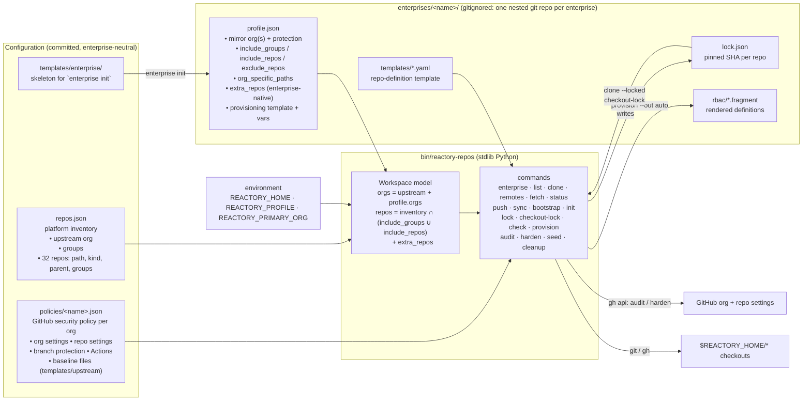
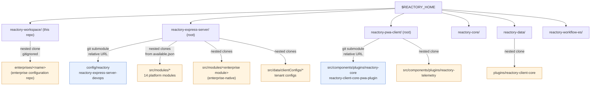
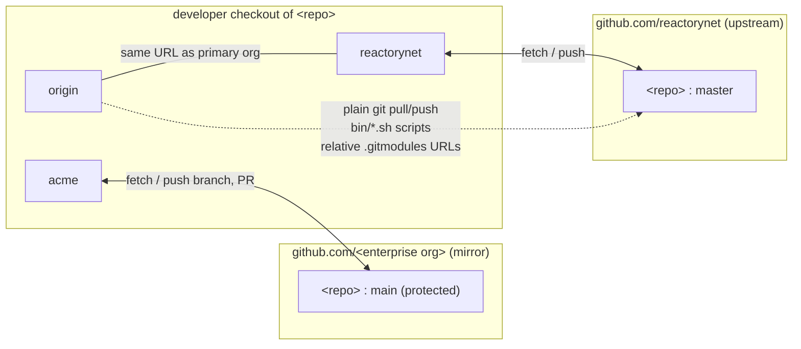
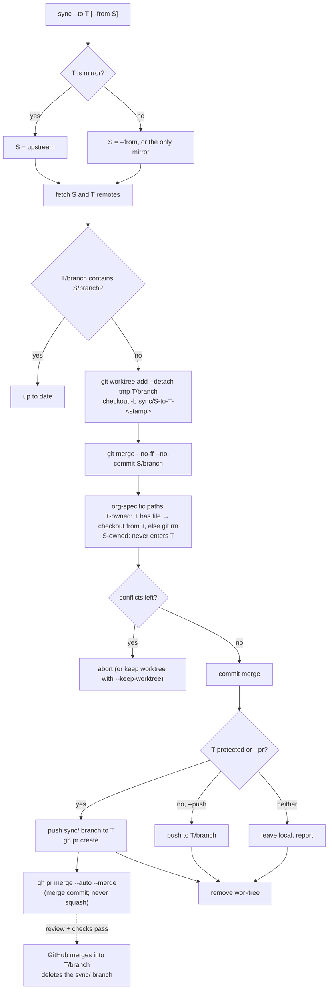
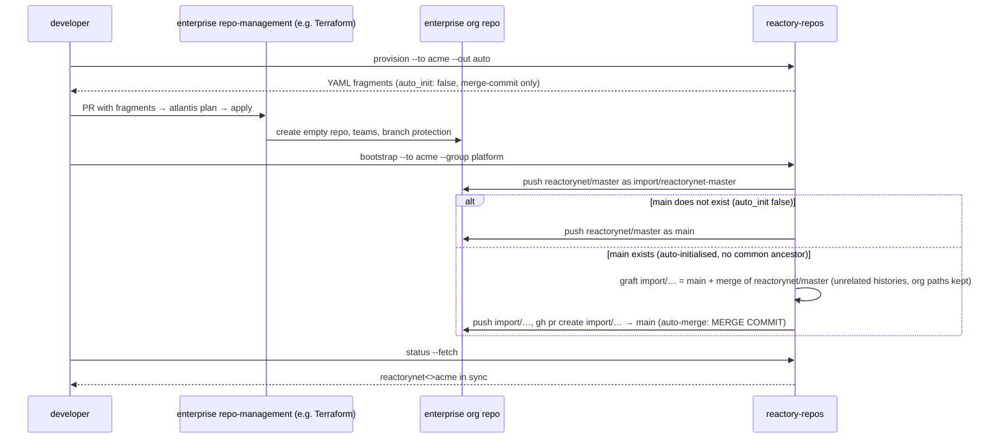

# Architecture: configuration-driven multi-org workspace

This document explains how `reactory-workspace` turns two JSON files into a
working multi-organisation checkout, and how to reuse it for another
enterprise. Diagrams are Mermaid and render on GitHub.

## 1. Configuration model

Rules the model applies:

- An inventory repo is **mirrored** into every org of the active profile when
  one of its `groups` is in `include_groups`, or its name is in
  `include_repos`, and it is not in `exclude_repos`. Otherwise it is
  upstream-only (the reactorynet tenant configs, for example). `include_repos`
  takes a single repo from a group that is not mirrored as a whole; a name
  missing from the inventory in either list is an error.
- A profile's `extra_repos` are **enterprise-native**: they exist only in the
  named org. `no_repo: true` marks a folder that has no remote anywhere yet.
- Per-repo `orgs` and `branches` maps remain available for exceptions
  (different name in the mirror, non-default branch).
- An enterprise is selected with `--profile <name>` or `REACTORY_PROFILE`;
  with exactly one folder under `enterprises/` it is selected automatically.
  `--profile none` loads the inventory alone: one org, no mirroring.
- Paths named in a profile (the provisioning template) resolve against the
  enterprise repo first, then against the workspace.
- An org may name a `policy` file. `audit` compares the live GitHub org and
  repos with it, `harden` applies it, `seed` opens PRs with its baseline
  files. The upstream org uses `policies/public-upstream.json`.

## 2. What a checkout is made of

Blue: submodules, pinned by the parent's gitlink. Orange: nested clones in
gitignored folders, **not** pinned by anything in git. The inventory lists
all of them; the lock file pins them.

## 3. Remotes

`origin` is a convenience alias for the primary org. Everything cross-org
goes through the named remotes, so `push --to acme` can refuse the protected
default branch and `sync` always knows which side is which.

Relative submodule URLs (`../reactory-express-server-devops.git`) resolve
against the superproject's `origin`, so a clone from the mirror takes its
submodules from the mirror without changing the committed `.gitmodules`.

## 4. Sync flow

Every PR the tool opens (`push --pr`, `sync --pr`, `bootstrap --pr`,
`seed --pr`) is armed with GitHub auto-merge, so the merge happens when the
required review and checks pass, not when someone remembers. The method
depends on the branch's job: sync and import PRs use the org's
`merge_strategy` (a merge commit, because the two default branches must
keep a common ancestor); feature and seed PRs use `pr_merge_method`
(squash, with the PR title and body as the commit message). The head branch
is removed by the repository's `delete_branch_on_merge` setting, which both
the upstream policy and the provisioning template turn on; `cleanup --to
<org>` deletes branches that landed before that setting existed (heads of
merged PRs, and `cleanup_branch_prefixes` that are ancestors of the default
branch).

The org-specific-path rule is symmetric. Every org lists the paths it owns.
When an org is the **target**, its version of those paths is restored (absent
in the target means removed). When it is the **source**, its paths never cross
into the target. So the enterprise keeps its CODEOWNERS and injected workflows and never
sends them upstream; the upstream keeps its seeded CodeQL, Dependabot and
`SECURITY.md` and never sends them into the mirror.

## 5. First import into a new org repo

## 6. Adding another enterprise

1. `bin/reactory-repos enterprise init <name>` creates `enterprises/<name>/`
   from `templates/enterprise/` as a git repository of its own. Push it to
   the enterprise's organisation (`reactory-workspace-<name>`); other
   machines get it with `enterprise add <git-url>`. It is gitignored here.
2. Set the mirror org: `github_org`, `remote`, `default_branch`,
   `protected_default_branch`, `pr_title_prefix`, and how PRs land:
   `merge_strategy` (sync/import PRs, keep `merge-commit`), `pr_merge_method`
   (feature/seed PRs, `squash`), `auto_merge`, `cleanup_branch_prefixes`.
3. List the files that org injects into repositories under
   `org_specific_paths`. Anything the enterprise's repo-management system
   writes into repos belongs here, plus `CODEOWNERS`.
4. Choose `include_groups` (normally `["platform"]`), any single repos from
   other groups under `include_repos`, and any `exclude_repos`.
5. Add the enterprise's own modules and tenant configs under `extra_repos`.
6. Point `provisioning.template` at a template for the enterprise's repo
   system (adapt `templates/provisioning.yaml` in the enterprise repo;
   variables are `{{name}}`, `{{description}}`, `{{default_branch}}`,
   `{{upstream_org}}`, `{{upstream_name}}`, `{{github_org}}`, `{{letter}}`,
   `{{range}}`, plus anything in `vars`; conditionals are
   `{{#if has_dockerfile}}…{{/if}}` and `{{#if is_mirror}}…{{/if}}`).
7. Optionally point the org at a `policy` file (copy
   `policies/public-upstream.json`) so `audit` / `harden` / `seed` can keep
   its GitHub settings in line; the mirror org normally leaves this to its
   repo-management system.
8. Run `bin/reactory-repos --profile <name> list`, then `remotes`, `provision
   --out auto`, `bootstrap`, `lock`.

Nothing in the CLI names an enterprise or reactorynet; both come from the
files above, and the enterprise's files never enter this repository.
Several mirror orgs in one profile are allowed; `sync --to <upstream>` then
needs `--from <mirror>`.
