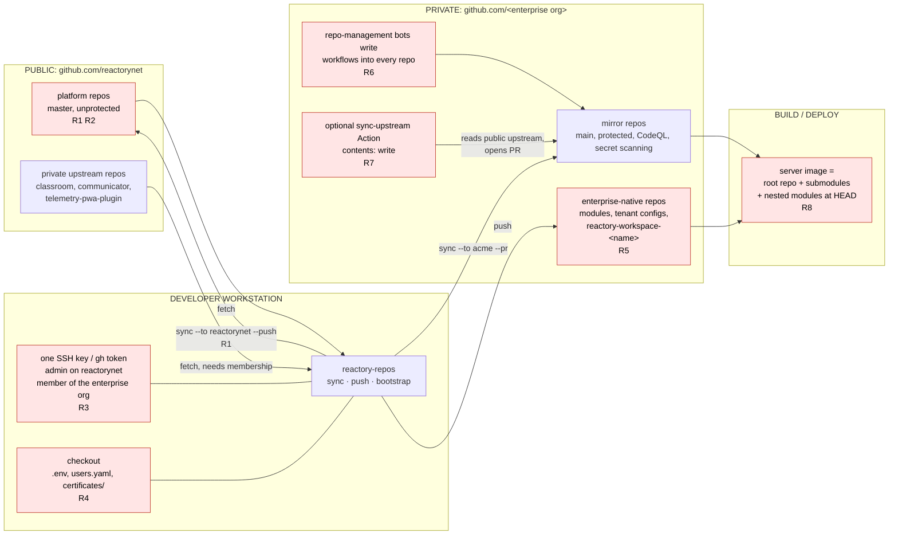
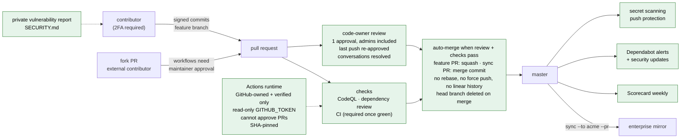
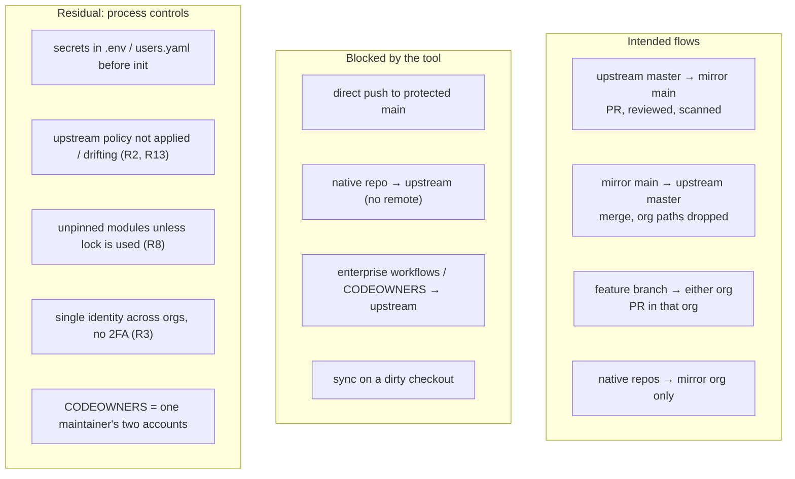

# Security model and risk register

Mirroring a platform between a public upstream organisation and a regulated
enterprise organisation creates a two-way channel. This document shows where
that channel can be abused or leak, what the tooling enforces, and what stays
a process control.

## 1. Trust boundaries and risk points

## 2. Risk register

| ID | Risk | Where | Enforced by the tool | Process control |
|---|---|---|---|---|
| **R1** | **Enterprise code or data pushed to the public upstream.** A sync into reactorynet carries every commit on the mirror's `main`, including anything merged there by mistake. | `sync --to reactorynet` | Enterprise-native repos are never in both orgs, so `sync` skips them. Org-specific paths (the enterprise's injected workflows, CODEOWNERS, catalogue files) are dropped on the way upstream. `sync` prints exactly what it merged. | Keep enterprise logic in **native repos** (modules, tenant configs) and enterprise configuration in `enterprises/<name>/` (its own repo, gitignored in the workspace), never in platform repos or in the workspace. Review `sync --to reactorynet -n` output before `--push`. Consider making the upstream sync a PR too (`--pr`) so a second person sees the diff. |
| **R2** | **Upstream `master` protection is inconsistent and excludes administrators.** Audit 2026-11-09: 16 of 27 public repos require no PR review, none require status checks, `enforce_admins` is off everywhere, so the two admin accounts can push straight to `master`; the next sync carries that into the enterprise. | reactorynet | Sync into the mirror is a PR against a protected `main` with CodeQL, SAST/SCA, dependency review and a code-owner review, never a direct push. `audit --to reactorynet` shows the drift; `harden --to reactorynet` applies `policies/public-upstream.json` (one code-owner review, admins included, signed commits, no force push, conversation resolution). | Keep the policy applied; treat `audit` drift as an incident. Make CI green, then add `required_checks` per repo so merges need passing checks. |
| **R3** | **One identity spans both orgs, and the upstream org does not require 2FA.** The developer's SSH key and `gh` token can push to either org; reactorynet members (4, two of them admins) may have no second factor; members may create public repositories. | workstation, reactorynet | Cross-org actions name the org explicitly; the protected-branch guard refuses direct pushes to either default branch. `audit` reports the 2FA requirement and repo-creation settings; `harden --org-level` disables member repo creation. | Require 2FA for reactorynet (web UI only). Hardware-backed SSH keys, SSO-authorised keys for the enterprise org, short-lived `gh` tokens, no long-lived PATs in dotfiles. Review the two admin accounts. |
| **R4** | **Secrets in the checkout.** `.env` files hold database, OAuth, Slack, Atlassian and AI provider credentials; a tenant config's `authentication/users.yaml` may hold seed passwords; `certificates/` holds keys. | checkout, native repos | `init` copies a `.gitignore` template before the first commit. Secret scanning and push protection are on for every mirror repo (provisioning template). | Before `init` on a tenant config, move passwords to `${ENV}` references or a secrets manager. Never `git add -f` an ignored file. Run a secret scan (gitleaks or `gh secret-scanning`) on native repos before the first push. |
| **R5** | **Native repos leak upstream by accident.** An enterprise module's `package.json` `repository.url`, or the server's committed `available.json`, can point at a reactorynet URL that does not exist yet; someone with reactorynet admin could create that repo and push. The enterprise configuration repo itself would leak team names and tracker keys if it were ever committed into the workspace. | native repos, workspace | Profile marks native repos as that org only; `remotes` removes any stale reactorynet remote; `push --to reactorynet` skips them. `enterprises/` is gitignored in the workspace. | Keep enterprise module URLs pointing at the enterprise org and list them in `available-private.json` (gitignored, merged by `install-modules.sh`). Before committing to the workspace, `git grep -i <enterprise>` must be empty. |
| **R6** | **Injected workflows flow back upstream.** Enterprise repo-management bots commit CodeQL, SAST, dependabot and policy workflows into mirror `main`. Pushed upstream they would run in reactorynet CI, fail, and expose the enterprise's infrastructure names. | mirror → upstream | Org-specific-path rule drops them on every sync toward upstream. | Add any new injected file to `org_specific_paths` when the enterprise's workflow set changes. `check` lists nothing for this yet; review the diff of a sync PR. |
| **R7** | **Automated sync with write permission.** The optional `sync-upstream.yaml` runs with `contents: write` and `pull-requests: write` on a GitHub-hosted runner and merges whatever public upstream contains. | enterprise Actions | It can only open a PR; merging still needs a code-owner review and green checks. Reads upstream over anonymous HTTPS: no secret to steal. | Keep it on GitHub-hosted runners (organisations often allow-list self-hosted runners per workflow). For private upstream repos use a **read-only** deploy key. Pin `actions/checkout` to a SHA before enabling (the seeded upstream workflows are SHA-pinned). |
| **R8** | **Unpinned supply chain.** Nested modules are cloned at the branch head by `install-modules.sh`; the server image is built from whatever is on disk. Dependabot alerts were off on 11 upstream repos and security updates on all 32; `reactory-core` alone had 89 open alerts. | build, dependencies | `lock` records a SHA per repo; `clone --locked` and `checkout-lock` reproduce it. `harden` turns on Dependabot alerts and security updates; `seed` adds `dependabot.yml` (npm, Actions, submodules) and dependency review on PRs. | Commit `lock.json` in the enterprise configuration repo, build only from a locked checkout in CI, and bump the lock through a PR so module updates are reviewed like any dependency. Work the alert backlog down before the first mirror import so the enterprise does not inherit it. |
| **R9** | **Relative submodule URL follows `origin`.** If `origin` is pointed at an attacker-controlled org, `git submodule update` fetches that org's submodule. | checkout | `remotes` resets `origin` to the configured primary org; `check` flags any deviation. | Only the two configured orgs are ever set as `origin`; treat a `check` warning as an incident, not noise. |
| **R10** | **Squash or rebase merge of a sync PR.** Breaks the shared ancestry: the next sync sees no common tip, re-merges the same changes and reports every file as divergent, inviting a hasty `--force`. Squash is *allowed* on both orgs' repos for ordinary feature PRs, so a human merging a sync PR by hand can pick it. | both orgs | The tool arms auto-merge on every sync/import PR with the **merge-commit** method, so the normal path never asks a human to choose; the PR body states the method; rebase is disabled on all repos. If a sync PR is squashed anyway, the next `sync` produces an empty re-linking merge commit that restores the common ancestor. | Let auto-merge land sync PRs; when merging one by hand, use the merge button's *merge commit* option. Never `push --force-protected` to resolve a bad merge. |
| **R11** | **History import bypasses review.** `bootstrap` pushes the full upstream history into a new org repo before any scanning has run on it. | first import | With `auto_init: false` the push creates `main` directly; secret scanning runs on push, CodeQL on the first PR. | Run the import from a trusted checkout, then open an empty PR to trigger CodeQL once, or import via an `import/` branch and PR when the enterprise requires a scan before anything reaches `main`. |
| **R12** | **Enterprise-only files reveal internal structure upstream through commit messages.** Sync merge commits list the org-specific paths they handled. | upstream history | Messages name paths only, never contents. | Keep `org_specific_paths` to file names that are not sensitive. |
| **R13** | **Upstream CI can be weaponised.** Every reactorynet repo allowed *any* third-party action, gave workflows a **write** `GITHUB_TOKEN` and let Actions approve PRs; fork PRs from anyone but first-time contributors ran without approval. A malicious or compromised action could push to `master` or approve its own PR. | reactorynet Actions | `harden` restricts actions to GitHub-authored and verified creators, sets the default token read-only, forbids PR approval by Actions and requires approval for every external contributor's fork PR. Seeded workflows pin actions to commit SHAs and declare minimal `permissions`. | Keep `ci.yml` / `build-smoke-test.yml` on the allowed list (GitHub-owned actions only today); add `permissions: contents: read` to them; review any new `uses:` in PRs. |
| **R14** | **Nobody can report a vulnerability privately.** No upstream repo had `SECURITY.md` or private vulnerability reporting; a finder's only route was a public issue. | reactorynet | `harden` enables private vulnerability reporting on public repos; `seed` adds `SECURITY.md` pointing at it. | Triage advisories; coordinate fixes with the enterprise before disclosure. |

## 3. Hardening the public upstream

The upstream is the enterprise's largest attack surface: everything on its
default branch reaches the mirror by design. `policies/public-upstream.json`
states what a public upstream org on the GitHub Free plan must look like;
three commands keep it that way.

| Command | Effect | Scope needed |
|---|---|---|
| `audit --to reactorynet` | Read-only comparison of the org and every repo with the policy; exit 1 on drift; `--json` report | `repo`, `read:org` |
| `harden --to reactorynet [-n]` | Applies the repo-level policy: settings, scanning, Actions permissions, branch protection, signatures | `repo` (org admin) |
| `harden --to reactorynet --org-level` | Also org settings: member repo creation, security defaults for new repos, org-wide Actions policy | `admin:org` |
| `seed --to reactorynet [--pr]` | Opens a PR per repo adding the baseline files from `templates/upstream`; auto-merge (squash) armed | `repo` |
| `cleanup --to reactorynet [-n] [--all-merged] [--local]` | Deletes remote branches that have landed: heads of merged PRs, merged `sync/` `security/` `import/` branches; reports repos where `delete_branch_on_merge` / `allow_auto_merge` are off | `repo` |

### 3.1 What the audit found (2026-11-09, 32 repos, 27 public)

| Control | State before |
|---|---|
| 2FA required for the org | no |
| Members may create (public) repositories | yes |
| Secret scanning / push protection / private vulnerability reporting | off on all 27 public repos |
| Dependabot alerts | off on 11 repos; security updates off on all 32 |
| Branch protection on the default branch | present on 27 public repos, but 16 require no review, 0 require checks, `enforce_admins` off on all |
| Signed commits required | yes, on all public repos |
| Linear history required | on 6 repos (incompatible with merge-commit sync) |
| GitHub Actions | any action allowed, write token, Actions may approve PRs, fork PRs run after first contribution |
| `SECURITY.md`, `dependabot.yml`, CodeQL, dependency review, Scorecard | absent everywhere; `CODEOWNERS` in 6 repos |
| Default branch | `reactory-temporal` defaults to a feature branch |
| Third-party apps | GitGuardian installed on all repos (keep) |

**Applied 2026-11-09.** `harden --to reactorynet` ran on all 32 repos with
no errors (fork-PR approval is n/a on private repos). A re-audit passes every
settings, scanning, Actions and branch-protection control; the remaining
drift is the baseline files, which are in 29 open `security/baseline-*` PRs
(auto-merge armed on the public repos; the 6 private ones need a manual
merge). `reactory-temporal` first had its protection land on a feature
branch that was the default at the time; after `master` was made the
default, `harden --repo reactory-temporal` protected `master`, auto-merge
was armed on its already-approved PR and it squashed in at once, the first
repo fully compliant; the stale protection on
`feature/workflow-step-integration` was removed afterwards. Later the same
day this repository itself was published as the private
`reactorynet/reactory-workspace`, hardened and seeded (`CODEOWNERS`,
`SECURITY.md`, an Actions-only `dependabot.yml`; CodeQL and the other
workflows are public-only). GitHub refuses auto-merge on private Free-plan
repos, but `gh pr merge --auto` merges a PR that is already mergeable on
the spot, which is how the workspace, `reactory-communicator` and
`reactory-classroom` baselines landed without a review; the
remaining private ones (`reactor-express-client-config`,
`booktutor-express-client-config`, `reactor-system-navigator`) were left for
a human to merge. Two private repos
(`reactory-telemetry-pwa-plugin`, `reactory-student-app-express-config`) are
empty on GitHub and cannot be seeded until something is pushed. Org-level
settings and the 2FA requirement are still pending (`admin:org`, web UI).

### 3.2 The control chain the policy creates

### 3.3 Consequences to accept before running `harden`

- **Administrators lose self-merge.** With `enforce_admins: true` and one
  required code-owner review, nobody merges their own PR into `master`
  without a second person. Today `CODEOWNERS` lists two accounts of the same
  maintainer; a second reviewer (for example enterprise developers who are
  already reactorynet members) should be added to `CODEOWNERS` and the
  policy's `vars.codeowners`.
- **Direct pushes to `master` stop**, for the tool too: `repos.json` now
  marks the upstream `protected_default_branch: true`, so `sync --to
  reactorynet` needs `--pr` and `push --to reactorynet` refuses `master`.
- **Sync merge commits must be signed.** `check` verifies
  `commit.gpgsign` and a signing key; the enterprise-side merge button signs with
  GitHub's key.
- **Merges become automatic once approved.** `allow_auto_merge` is on and the
  tool arms auto-merge on every PR it opens, so the code-owner approval *is*
  the merge decision; there is no second "merge" click to reconsider. The
  head branch disappears on merge (`delete_branch_on_merge`), and
  `cleanup` removes the stale branches from before (over a hundred merged-PR
  branches across the reactorynet repos on 2026-11-09). A stale branch is
  recoverable from the merged PR, not from the remote.
- **Linear history is switched off** on the six repos that had it; cross-org
  sync needs merge commits.
- **Required status checks start empty.** CI on `master` was failing on
  2026-11-09; add `"required_checks": ["typecheck", "lint", ...]` to a
  repo's inventory entry once its checks are green.
- **Private repos** (8) get Dependabot and Actions hardening only; branch
  protection and secret scanning need GitHub Team or a public repo.
- **Not automatable:** the 2FA requirement (web UI), and `admin:org` scope
  for the org-level part (`gh auth refresh -h github.com -s admin:org`).

### 3.4 Upstream-owned paths

The seeded files are listed under the upstream org's `org_specific_paths`,
so a sync into the mirror drops them (the enterprise injects its own
CodeQL, Dependabot and `SECURITY.md`) and a sync from the mirror cannot
alter them. The rule is now symmetric: each org's list is kept from that
org when it is the target and never crosses when it is the source.

## 4. Data-flow summary

## 5. Checklist before the first bootstrap into an enterprise

- [ ] Profile reviewed: `include_groups`, `exclude_repos`, `extra_repos`, `org_specific_paths`.
- [ ] `bin/reactory-repos check` clean; no absolute `.gitmodules` URLs; `origin` on the primary org.
- [ ] Secret scan of every native repo and of the checkout folders that will be `init`ed.
- [ ] `users.yaml` seed passwords replaced by environment references.
- [ ] Repo definitions applied with `auto_init: false`, rebase disabled, auto-merge and delete-branch-on-merge on, secret scanning on.
- [ ] `cleanup --to all -n` reviewed, then run; `sync` PRs land as merge commits (check the first one).
- [ ] `lock` committed; CI builds from `clone --locked`.
- [ ] `audit --to reactorynet` clean, or every remaining drift item accepted in writing.
- [ ] 2FA required on the upstream org; `CODEOWNERS` names a second reviewer.
- [ ] Baseline files merged (`seed --to reactorynet --pr`); CodeQL and dependency review green on a test PR.
